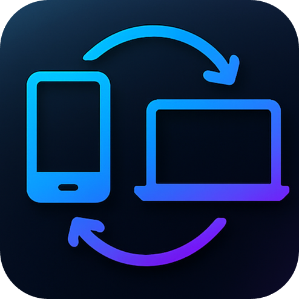
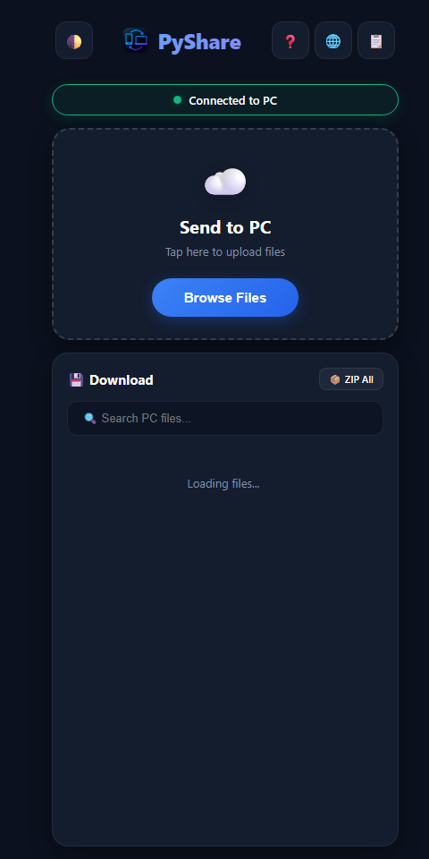
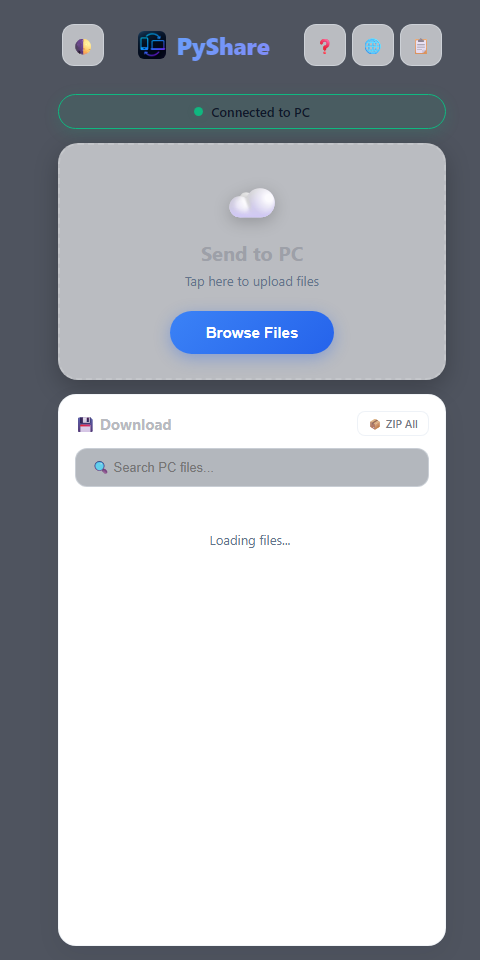
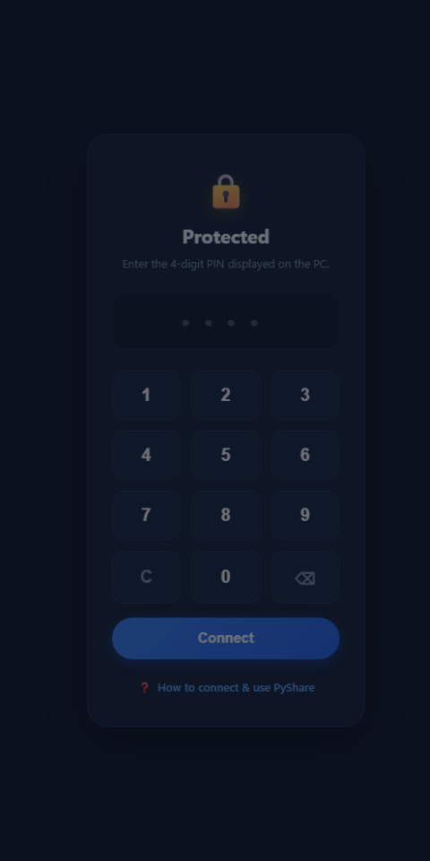
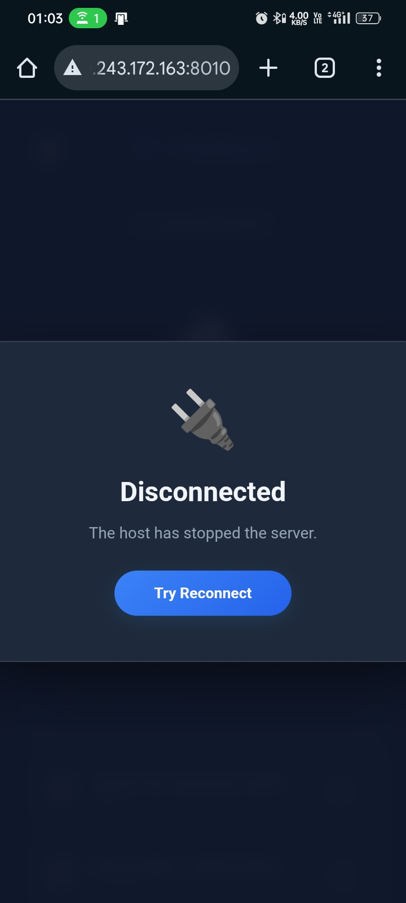

<div align="center">

  <h1 align="center">
  
  
  PyShare v4.0.0
</h1>
  <strong>A modern, high-speed, local Wi-Fi file & clipboard sharing hub between PC and Mobile devices.</strong>

  <p>
    <a href="#-download-standalone-windows-app">Download</a> •
    <a href="#-whats-new-in-v400">What's New</a> •
    <a href="#-features">Features</a> •
    <a href="#%EF%B8%8F-usage-guide">Usage</a> •
    <a href="#%EF%B8%8F-development--installation">Development</a>
  </p>

</div>

<br>

**PyShare** is an ultra-fast, privacy-first local network transfer tool. Connect your phone and PC over local Wi-Fi in seconds with zero configuration, no cables, and no external internet required.

---

## 📥 Download Standalone Windows App

**Windows Users:** Run PyShare directly as a single portable application—no Python installation or complex setup required!

* **PyShare (Windows Standalone EXE)** 👉 **[Download PyShare.exe](https://github.com/pattanayakpratik/PyShare/releases/download/v4.0.0/PyShare.exe)**
* **PyShare (Compressed ZIP)** 👉 **[Download PyShare.zip](https://github.com/pattanayakpratik/PyShare/releases/download/v4.0.0/PyShare.zip)**

*⚠️ **Note:** If Windows SmartScreen displays a warning on first launch, click **More info → Run anyway**. PyShare is 100% open-source and operates strictly on your local Wi-Fi.*

---

## 🆕 What's New in v4.0.0

- 🖼️ **In-App Media Preview Lightbox:**
  - View full-resolution photos directly in the browser.
  - Stream HTML5 videos with seeking and scrubbing controls.
  - Listen to audio tracks with an integrated playback card.
  - Read code and text files with syntax formatting and a 1-click **Copy Text** button.
- ⚡ **HTTP 206 Partial Content (Range Requests):**
  - Smooth, buffer-free video/audio scrubbing and seeking on iOS Safari, Android Chrome, and desktop browsers.
- 📋 **Universal Shared Clipboard:**
  - Instantly sync text snippets, links, notes, and addresses between phone and PC in real time.
- 📦 **Download All as ZIP:**
  - Archive and download entire directories (`Shared_Files` or `Received_Files`) in a single click.
- 🚀 **Multi-File Upload Queue & Live Speed Meter:**
  - Track individual file progress bars, overall status, and real-time transfer speed (`MB/s` / `KB/s`).
- 🛡️ **Collision-Safe File Saving:**
  - Prevents accidental overwrites by automatically indexing duplicates (`file (1).ext`).
- 🔑 **Dual-Grace PIN Rotation:**
  - Seamless 30-second PIN rotation with a grace window so typing right at the boundary never causes accidental lockouts.
- 📱 **Dynamic QR Generation & mDNS Discovery:**
  - Automatically regenerates QR codes dynamically on IP/port changes and broadcasts via `_pyshare._tcp.local.`.
- 🗑️ **In-App Host File Deletion:**
  - Manage and clean up files directly from the web dashboard.
- 🗂️ **Category Filtering:**
  - Quick-filter files by category chips: **All**, **Images**, **Videos**, **Docs**, **Audio**.

---

## 🚀 Key Features

- **🎨 Glassmorphic Design:** Modern frosted glass design with responsive layouts for mobile and desktop screens.
- **📂 Desktop Integration:** Automatically creates and organizes `PyShare_Files/Shared_Files` and `Received_Files` on your Desktop.
- **⚡ Zero Configuration:** Auto-detects local IP, finds available ports (8010–8020), and launches your browser on startup.
- **🌗 Dark & Light Themes:** Crisp high-contrast dark theme by default with easy toggle to light theme.
- **☁️ Touch & Drag-and-Drop:** Intuitive file dropping on desktop and touch-friendly file picker on mobile.
- **🔒 Local Network Security:** Requires rotating 4-digit PIN authentication. Client heartbeat detector alerts you immediately if the host disconnects.
- **🛡️ 100% Offline & Private:** All data travels straight across your Wi-Fi network without leaving your local environment.

---

## 📸 Screenshots

### 🖥️ Host View


### 📱 Client View
<div align="center">
  
  
  
  
</div>

---

## 🖥️ Usage Guide

### 1. Start PyShare
* **Standalone App:** Double-click `PyShare.exe`.
* **Python Script:** In terminal, run `python main.py`.

### 2. Connect Your Phone
1. Connect your phone to the **same Wi-Fi network** as your PC.
2. Scan the **QR Code** on the host screen using your phone's camera.
3. Enter the **4-digit PIN** displayed on the host screen.

### 3. Share Files & Clipboard
* **Send from Phone:** Tap **Send to PC** or drag files to upload. Files appear in `Desktop/PyShare_Files/Received_Files`.
* **Download to Phone:** Tap any file to preview, download individually, or tap **📦 ZIP All** to download the whole folder.
* **Shared Clipboard:** Paste or type text/links into the clipboard box and hit **Send** to instantly push across devices.

### 4. Stop Server
* Click the red **🛑 Shutdown** button in the top navigation bar or press `Ctrl + C` in the console.

---

## 🛠️ Development & Installation

For developers running or contributing from source:

```bash
# Clone the repository
git clone https://github.com/pattanayakpratik/PyShare.git
cd PyShare

# Create and activate virtual environment
python -m venv .venv
.venv\Scripts\activate   # Windows (or source .venv/bin/activate on Unix)

# Install dependencies
pip install -r requirements.txt

# Run the server
python main.py

# Build standalone Windows executable
pyinstaller --noconfirm --clean --onefile --windowed `
  --add-data "host.html;." --add-data "client.html;." --add-data "login.html;." `
  --add-data "styles.css;." --add-data "host_styles.css;." --add-data "client_styles.css;." `
  --add-data "scripts.js;." --add-data "host_scripts.js;." --add-data "app_icon.ico;." `
  --icon app_icon.ico --name "PyShare" main.py
```

---

## 📜 License

This project is licensed under the MIT License - see the [LICENSE](LICENSE) file for details.
