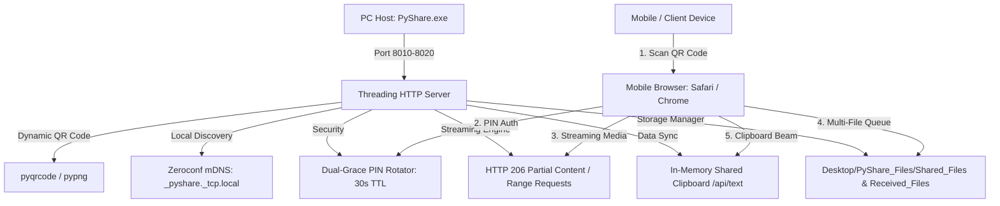

# ⚡ PyShare — High-Speed Local Wi-Fi File Transfer & Clipboard Hub

<div align="center">


<br/><br/>


<br/>

**A modern, ultra-fast, local network file transfer & clipboard hub. Connect your PC and mobile devices over local Wi-Fi in seconds with zero configuration, no cables, and no external internet required.**

<br/>

[⬇️ **Download Standalone EXE (v4.0.0)**](https://github.com/pattanayakpratik/PyShare/releases/download/v4.0.0/PyShare.exe) • [📦 **Download ZIP**](https://github.com/pattanayakpratik/PyShare/releases/download/v4.0.0/PyShare.zip) • [Screenshots](#-screenshots) • [What's New](#-whats-new-in-v400) • [Key Features](#-key-features) • [Usage Guide](#-usage-guide) • [Installation](#-installation-for-developers)

</div>

---

## 📸 Screenshots

### 🖥️ Desktop Host View

<p align="center">
  
</p>

### 📱 Mobile Client Views

<p align="center">
  
  
</p>
<p align="center">
  
  
</p>

---

## 📥 Download Standalone Windows App

**Windows Users:** Run PyShare directly as a single portable application — **zero Python setup required.**

* **PyShare (Windows Standalone EXE)** 👉 **[Download PyShare.exe](https://github.com/pattanayakpratik/PyShare/releases/download/v4.0.0/PyShare.exe)**
* **PyShare (Compressed ZIP Archive)** 👉 **[Download PyShare.zip](https://github.com/pattanayakpratik/PyShare/releases/download/v4.0.0/PyShare.zip)**
* **GitHub Releases** 👉 **[PyShare v4.0.0 Release](https://github.com/pattanayakpratik/PyShare/releases/tag/v4.0.0)**

> [!NOTE]
> If Windows SmartScreen shows a warning on first launch, click **More info → Run anyway**. PyShare is 100% open-source and operates strictly on your local Wi-Fi.

---

## 🆕 What's New in v4.0.0

- 🖼️ **In-App Media Preview Lightbox:**
  - View full-resolution photos directly in your browser.
  - Stream HTML5 videos with seeking and scrubber controls.
  - Integrated audio player for smooth audio playback.
  - In-browser code and text viewer with syntax formatting and a 1-click **Copy Text** button.
- ⚡ **HTTP 206 Partial Content (Range Requests):**
  - Smooth, buffer-free video and audio seeking without buffering pauses, fully compatible with iOS Safari and Android Chrome.
- 📋 **Universal Shared Clipboard:**
  - Beam text snippets, URLs, notes, and addresses bidirectionally between your phone and PC in real time.
- 📦 **Download All as ZIP:**
  - 1-click archiving of entire folders (`Shared_Files` or `Received_Files`) on the fly.
- 🚀 **Multi-File Upload Queue & Speed Meter:**
  - Floating upload drawer with individual per-file progress bars and real-time transfer speed (`MB/s` / `KB/s`).
- 🛡️ **Collision-Safe File Renaming:**
  - Automatically indexes duplicate uploads (`file (1).ext`) to ensure existing files are never overwritten.
- 🔑 **Dual-Grace PIN Rotation:**
  - 30-second PIN rollover with a grace window so entering the PIN right at the boundary never causes accidental lockouts.
- 📱 **Dynamic QR Generation & mDNS Broadcast:**
  - Regenerates QR codes automatically whenever IP or port changes and broadcasts via `_pyshare._tcp.local.`.
- 🗑️ **In-App Host File Deletion:**
  - Delete and manage received or shared files directly from the web dashboard.

---

## ⚡ Key Features

- **🎨 Modern Dark Navy Aesthetic:** Beautifully balanced layout matching desktop studio standards and touch-friendly mobile conventions.
- **📂 Automatic Desktop Integration:** Automatically creates and organizes `PyShare_Files/Shared_Files` and `Received_Files` on your Desktop.
- **⚡ Zero Configuration:** Auto-detects local IP, finds available ports (8010–8020), and launches your browser on startup.
- **🌗 Dark & Light Themes:** Crisp dark theme by default with smooth switching to light theme.
- **☁️ Touch & Drag-and-Drop:** Intuitive file dropping on desktop and touch-friendly file picker on mobile.
- **🔒 Local Network Security:** Requires rotating 4-digit PIN authentication. Client heartbeat detector alerts you immediately if the host disconnects.
- **🛡️ 100% Offline & Private:** All data travels straight across your Wi-Fi network without leaving your local environment.

---

## 📂 System Architecture

```text
PyShare/
├── main.py              # HTTP Server, SSE Push Engine, Range Streaming, PIN Ticker & mDNS
├── host.html            # Host 3-column studio dashboard
├── host_styles.css      # Host desktop layout styling
├── host_scripts.js      # Host SSE listener, PIN sync, RX monitor & Windows clipboard sync
├── client.html          # Mobile-first client interface with PWA support
├── client_styles.css    # Client touch-friendly layout
├── login.html           # 4-digit PIN authentication keypad
├── styles.css           # Global design system & Lightbox modal
├── scripts.js           # Multi-file upload queue, SSE event stream & media preview
├── manifest.json        # Progressive Web App (PWA) manifest
├── sw.js                # Service Worker for standalone mobile PWA
├── requirements.txt     # Python dependencies
├── app_icon.ico         # Application icon for Windows executable
├── app_icon.png         # Cross-platform web icon for desktop and mobile browsers
└── Screenshots/         # High-resolution dashboard captures
    ├── banner.png
    ├── host_dark.png
    ├── host_white.png
    ├── client_dark.jpg
    ├── client_white.jpg
    ├── client_login.jpg
    └── client_disconnect.jpg
```



---

## 🖥️ Usage Guide

### 1. Launch PyShare
* **Windows App:** Double-click `PyShare.exe`.
* **From Source:** Open terminal in the `PyShare` folder and run `python main.py`.

### 2. Connect Your Phone
1. Connect your phone to the **same Wi-Fi network** as your PC.
2. Scan the **QR Code** displayed on the host screen using your phone's camera.
3. Enter the **4-digit PIN** shown on your PC (it refreshes every 30s).

### 3. Share Files & Clipboard
* **Send from Phone:** Tap **Browse Files** or drag files to upload. Files appear in `Desktop/PyShare_Files/Received_Files`.
* **Download to Phone:** Tap any file to preview, download individually, or tap **📦 ZIP All** to download the whole folder.
* **Shared Clipboard:** Tap **📋** in the top navigation bar to open the clipboard drawer, view shared text, copy it, or send new text.

### 4. Stop Server
* Click the red **🛑 Shutdown** button in the top navigation bar or press `Ctrl + C` in the terminal.

---

## 🛠️ Installation (For Developers)

```bash
# 1. Clone repository
git clone https://github.com/pattanayakpratik/PyShare.git
cd PyShare

# 2. Create virtual environment
python -m venv .venv
.venv\Scripts\activate   # Windows (or source .venv/bin/activate on macOS/Linux)

# 3. Install dependencies
pip install -r requirements.txt

# 4. Run PyShare
python main.py

# 5. Build standalone Windows executable
pyinstaller --noconfirm --clean --onefile --windowed `
  --add-data "host.html;." --add-data "client.html;." --add-data "login.html;." `
  --add-data "styles.css;." --add-data "host_styles.css;." --add-data "client_styles.css;." `
  --add-data "scripts.js;." --add-data "host_scripts.js;." `
  --add-data "app_icon.ico;." --add-data "app_icon.png;." `
  --add-data "manifest.json;." --add-data "sw.js;." `
  --icon app_icon.ico --name "PyShare" main.py
```

---

## 📜 License

This project is licensed under the MIT License - see the [LICENSE](LICENSE) file for details.
