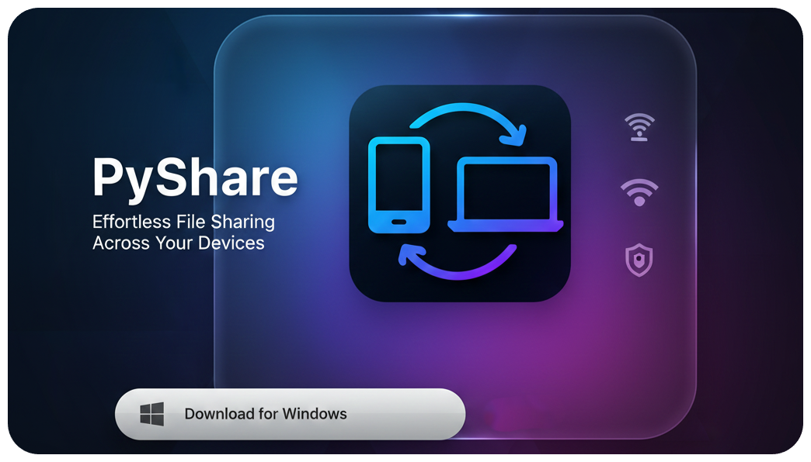
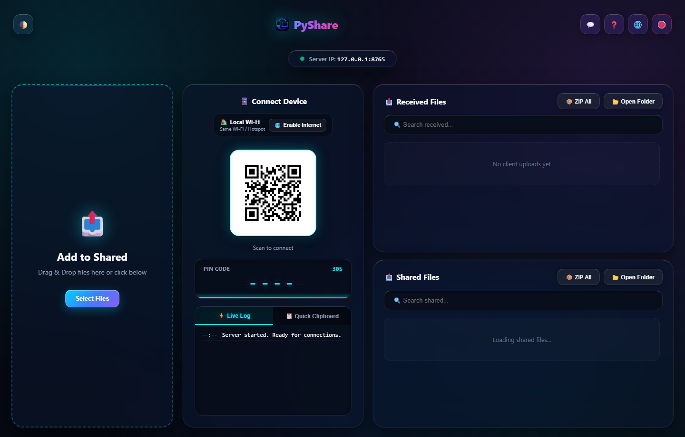
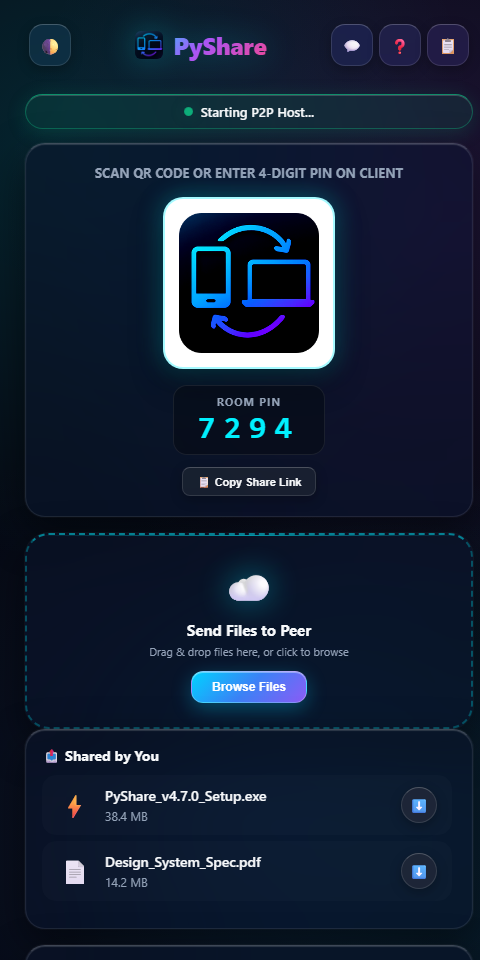
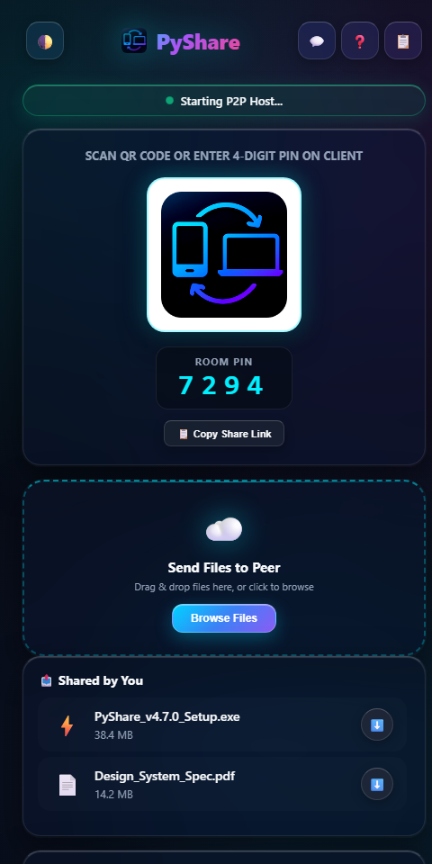
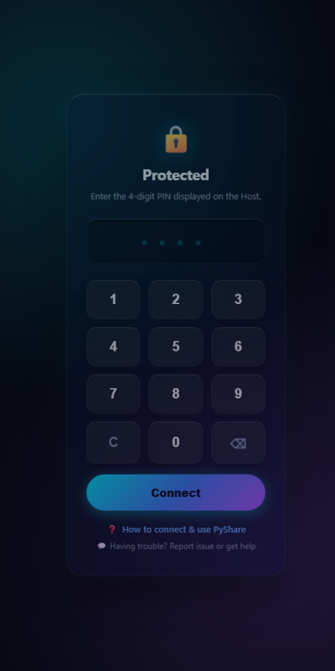
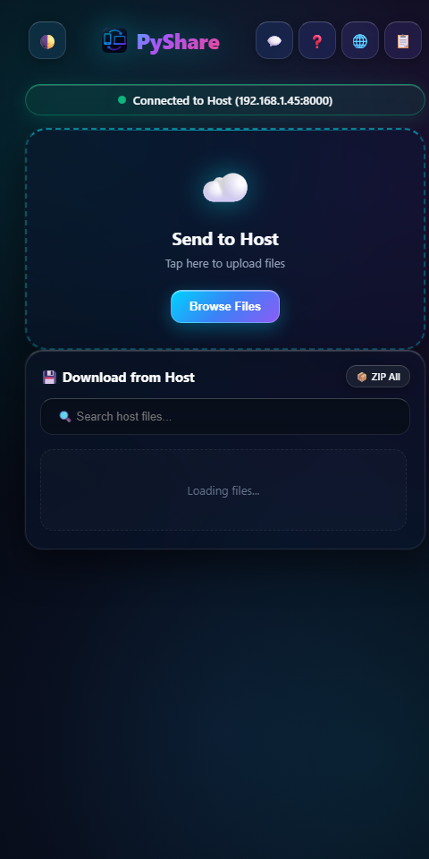
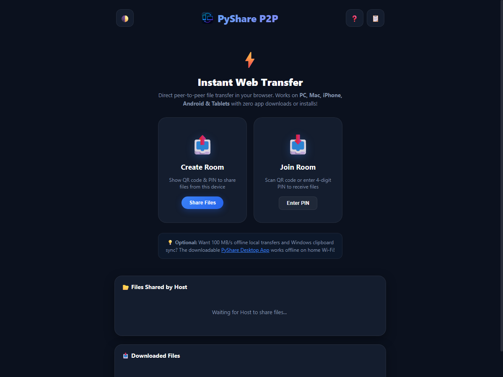
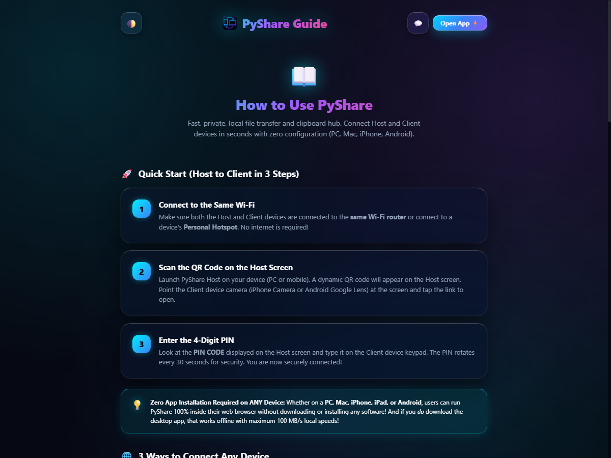
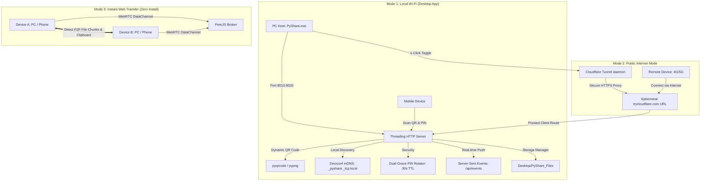

# ⚡ PyShare — High-Speed Cross-Device File Transfer & Clipboard Hub

<div align="center">



<br/><br/>


[](https://pyshare.vercel.app)


<br/>

**A modern, ultra-fast cross-platform file transfer & universal clipboard hub. Transfer photos, videos, documents, and text between PC, Mac, iPhone, Android, and Tablets with zero configuration — try it live at [pyshare.vercel.app](https://pyshare.vercel.app).**

<br/>

[🌐 **Open Web App (pyshare.vercel.app)**](https://pyshare.vercel.app) • [⬇️ **Download Standalone EXE**](https://github.com/pattanayakpratik/PyShare/releases/download/v4.6.0/PyShare.exe) • [📦 **Download ZIP**](https://github.com/pattanayakpratik/PyShare/releases/download/v4.6.0/PyShare.zip) • [Screenshots](#screenshots) • [Two Ways to Use](#two-ways-to-use-pyshare) • [What's New](#whats-new) • [Key Features](#key-features) • [Architecture](#system-architecture) • [Usage Guide](#usage-guide)

</div>

---

<span id="two-ways-to-use-pyshare"></span>
## 🚀 Two Ways to Use PyShare

PyShare is built around complete flexibility: **downloading an app is 100% optional!**

| Mode | 🌐 1. Instant Web Mode (Zero Install) | 💻 2. Desktop App Mode (`.exe`) |
| :--- | :--- | :--- |
| **Download Needed?** | ❌ **No downloads required** | Optional portable `.exe` |
| **Supported Devices** | PC, Mac, Linux, iPhone, Android, iPad | Windows PC / Laptop |
| **How to Access** | Open [pyshare.vercel.app](https://pyshare.vercel.app) in any browser | Double-click to launch offline hub |
| **Network** | Any Wi-Fi, 4G/5G, or Cellular | 100% Offline Wi-Fi LAN / Hotspot + Cloudflare Tunnel |
| **Transfer Speed** | Peer-to-Peer WebRTC DataChannels | Ultra-fast Local Stream (**50–100 MB/s**) |
| **File Storage** | Direct in-browser download & Lightbox | Auto-saved to `Desktop/PyShare_Files` |
| **Clipboard** | Synced Web Clipboard modal | Native 1-click Windows OS Clipboard Push |

---

<span id="screenshots"></span>
## 📸 Screenshots

### 🖥️ Desktop Host Studio (Dark & Light Mode)
The complete workstation command center on PC with live dynamic QR code, rotating 4-digit PIN, 1-click Cloudflare Internet Tunnel toggle, Windows OS clipboard push, and received files manager.

<p align="center">
  
  
</p>

### 📱 Mobile Phone as Host (Zero PC Required — Dark & Light Mode)
Your phone can now act as the **Host** directly from any mobile browser! Phone A taps **Create Room** to generate an instant Room PIN and QR code; Phone B or PC connects to send/receive files peer-to-peer over WebRTC with zero app installation.

<p align="center">
  
  
</p>

### 📱 Mobile Client Views & PIN Login
Touch-friendly mobile interface with PIN keypad authentication, built-in How-To Guide shortcut, media preview lightbox, real-time upload progress, and 1-tap theme switching.

<p align="center">
  
  
  
</p>

### 🌐 Instant Web Transfer & 📖 Interactive How-To Guide
Left: Direct browser-to-browser WebRTC file sharing on desktop with drag-and-drop. Right: Built-in visual user manual and troubleshooting guide precached for offline use.

<p align="center">
  
  
</p>

---

<span id="download"></span>
## 📥 Download Standalone Windows App

**Windows Users:** Run PyShare directly as a single portable application — **zero Python setup required.**

* **PyShare (Windows Standalone EXE)** 👉 **[Download PyShare.exe](https://github.com/pattanayakpratik/PyShare/releases/download/v4.6.0/PyShare.exe)**
* **PyShare (Compressed ZIP Archive)** 👉 **[Download PyShare.zip](https://github.com/pattanayakpratik/PyShare/releases/download/v4.6.0/PyShare.zip)**
* **GitHub Releases** 👉 **[PyShare Releases](https://github.com/pattanayakpratik/PyShare/releases)**

> [!NOTE]
> If Windows SmartScreen shows a warning on first launch, click **More info → Run anyway**. PyShare is 100% open-source and operates strictly within your local environment.

---

<span id="whats-new"></span>
## 🆕 What's New in v4.6.0

- 💬 **Universal Help & Feedback System:**
  - One-click feedback modal accessible across all interfaces (Host, Client, Web P2P, Login, and Guide).
  - Category selector (🐛 Bug, 💡 Feature Idea, ❓ Question, ⭐ Feedback), 1–5 star rating, problem textarea, and auto-detected device diagnostics.
  - Zero local device clutter: All feedback from both Host and Client is securely delivered straight to the developer via Formspree.
  - Offline GitHub Issue generator fallback if the device is disconnected from the internet.
- 🔄 **Universal Host & Client Terminology:**
  - Cleanly decoupled rigid "PC" and "Mobile" labels into universal "Host" and "Client", allowing phones and PCs to act as either Host or Client seamlessly.
- 🌐 **Instant Web Transfer (WebRTC P2P):**
  - Transfer files directly between any two browsers (PC, Mac, iPhone, Android, Tablet) with **zero app downloads**.
  - Desktop drag-and-drop file upload and physical keyboard PIN entry.
- 🌍 **1-Click Cloudflare Internet Tunnel:**
  - Share files securely with phones on 4G/5G mobile data, college Wi-Fi (AP Isolation), or across the world with end-to-end HTTPS encryption.
- 📖 **Interactive How-To Guide (`guide.html`):**
  - Built-in visual manual and troubleshooting wizard accessible directly from the navbar and login screen with zero authentication required.
- 📋 **Native OS Clipboard Integration:**
  - 1-click **"Push PC Clipboard"** button pushes your current Windows clipboard (`pyperclip`) to all connected mobile devices in real time.
- ⚡ **Server-Sent Events (SSE) Push Engine:**
  - Replaced interval polling with instant push notifications for file additions, PIN rotation, and clipboard updates via `/api/events`.
- 📦 **Zero-RAM ZIP Streaming (`/api/zip`):**
  - Streams gigabyte-sized folders in disk-backed compressed archives without memory exhaustion.
- 📱 **Progressive Web App (PWA v5):**
  - Installable to iOS & Android home screens via `manifest.json` and offline-first caching with `sw.js`.
- 🖼️ **In-App Media Preview Lightbox:**
  - Full-resolution photo preview, HTML5 video streaming with seeking, audio player, and code/text viewer with 1-click copy.

---

<span id="key-features"></span>
## ⚡ Key Features

- **🎨 Modern Dark Navy Studio Aesthetic:** Clean, balanced interface matching desktop workstation standards and touch-friendly mobile conventions.
- **📂 Automatic Desktop Integration:** Automatically creates and organizes `PyShare_Files/Shared_Files` and `Received_Files` on your Windows Desktop.
- **⚡ Zero Configuration:** Auto-detects your primary physical network adapter (skips virtual/WSL bridges), finds open ports (8010–8020), and launches your browser on startup.
- **🔒 Rotating PIN Security:** Dual-grace 30-second PIN rollover prevents unauthorized access while ensuring no accidental lockouts during typing.
- **🛡️ 100% Private:** In local mode, all data travels straight across your Wi-Fi or phone hotspot without touching any external cloud servers.
- **🌗 Light & Dark Themes:** Smooth theme switching with persistent local storage.

---

<span id="system-architecture"></span>
## 📂 System Architecture

```text
PyShare/
├── main.py              # HTTP Server, SSE Push Engine, Range Streaming, Cloudflare Tunnel & mDNS
├── host.html            # Host 3-column studio dashboard with Internet mode & clipboard sync
├── host_styles.css      # Host desktop layout styling
├── host_scripts.js      # Host SSE listener, PIN sync, RX monitor & Windows clipboard sync
├── feedback.js          # Universal Feedback & Help modal, device diagnostics & GitHub Issue fallback
├── client.html          # Mobile-first client interface with PWA support
├── client_styles.css    # Client touch-friendly layout
├── login.html           # 4-digit PIN authentication keypad with guide shortcut
├── guide.html           # Interactive visual How-To Guide & troubleshooting wizard
├── p2p.html             # Universal Web Transfer interface (Zero App Install Required)
├── p2p.js               # WebRTC P2P chunking, transfer queue, drag-and-drop & keyboard PIN
├── peerjs.min.js        # Vendored PeerJS WebRTC data broker
├── qrcode.min.js        # Vendored client-side QR code generator
├── styles.css           # Global design system & Lightbox modal
├── scripts.js           # Multi-file upload queue, SSE event stream & media preview
├── manifest.json        # Progressive Web App (PWA) manifest
├── sw.js                # Service Worker for standalone mobile PWA (Cache v5)
├── vercel.json          # 1-click cloud deployment configuration
├── requirements.txt     # Python dependencies
├── app_icon.ico         # Application icon for Windows executable
├── app_icon.png         # Cross-platform web icon for desktop and mobile browsers
└── Screenshots/         # High-resolution dashboard captures
    ├── banner.png
    ├── host_dark.png
    ├── host_white.png
    ├── mobile_host_dark.png
    ├── mobile_host_white.png
    ├── client_dark.png
    ├── client_white.png
    ├── client_login.png
    ├── web_transfer.png
    └── guide.png
```



---

<span id="usage-guide"></span>
## 🖥️ Usage Guide

### 1. Launch PyShare
* **Desktop App:** Double-click `PyShare.exe`.
* **From Source:** Run `python main.py` in your terminal.
* **Instant Web Mode:** Open `p2p.html` in any browser or visit your deployed web URL.

### 2. Connect Any Device (Host &amp; Client)
1. Make sure both Host and Client devices are connected to the **same Wi-Fi router** or connect to a device's **Personal Hotspot**.
2. Scan the **QR Code** displayed on the Host screen with the Client device camera.
3. Enter the **4-digit PIN** displayed on the Host screen.

### 3. Share Files &amp; Clipboard
* **Send to Host:** Tap **Browse Files** or drag files to upload. Files are automatically saved into `Desktop/PyShare_Files/Received_Files` on the Host.
* **Download from Host:** Tap any file to preview, download individually, or tap **📦 ZIP All** to stream the whole folder.
* **Universal Clipboard:** Tap **📋** in the top navigation bar to view, copy, or beam text. On Host, click **"📋 Push Host Clipboard"** to send your clipboard instantly!
* **Need Internet Sharing?** Click **"🌐 Enable Internet"** on the Host to generate an instant Cloudflare tunnel for clients on cellular/mobile data.
* **Help &amp; Feedback:** Tap **💬** in the top navigation bar across any interface to report bugs, request features, or ask questions.

### 4. Stop Server
* Click the red **🛑 Shutdown** button in the top navigation bar or press `Ctrl + C` in your terminal.

---

<span id="installation"></span>
## 🛠️ Installation (For Developers)

```bash
# 1. Clone repository
git clone https://github.com/pattanayakpratik/PyShare.git
cd PyShare

# 2. Create virtual environment
python -m venv .venv
.venv\Scripts\activate   # Windows (or source .venv/bin/activate on macOS/Linux)

# 3. Install dependencies
pip install -r requirements.txt

# 4. Run PyShare
python main.py

# 5. Build standalone Windows executable
pyinstaller --noconfirm --clean --onefile --windowed `
  --add-data "host.html;." --add-data "client.html;." --add-data "login.html;." `
  --add-data "guide.html;." --add-data "p2p.html;." --add-data "p2p.js;." `
  --add-data "peerjs.min.js;." --add-data "qrcode.min.js;." `
  --add-data "styles.css;." --add-data "host_styles.css;." --add-data "client_styles.css;." `
  --add-data "scripts.js;." --add-data "host_scripts.js;." --add-data "feedback.js;." `
  --add-data "app_icon.ico;." --add-data "app_icon.png;." `
  --add-data "manifest.json;." --add-data "sw.js;." `
  --icon app_icon.ico --name "PyShare" main.py
```

---

## 📜 License

This project is licensed under the MIT License - see the [LICENSE](LICENSE) file for details.
